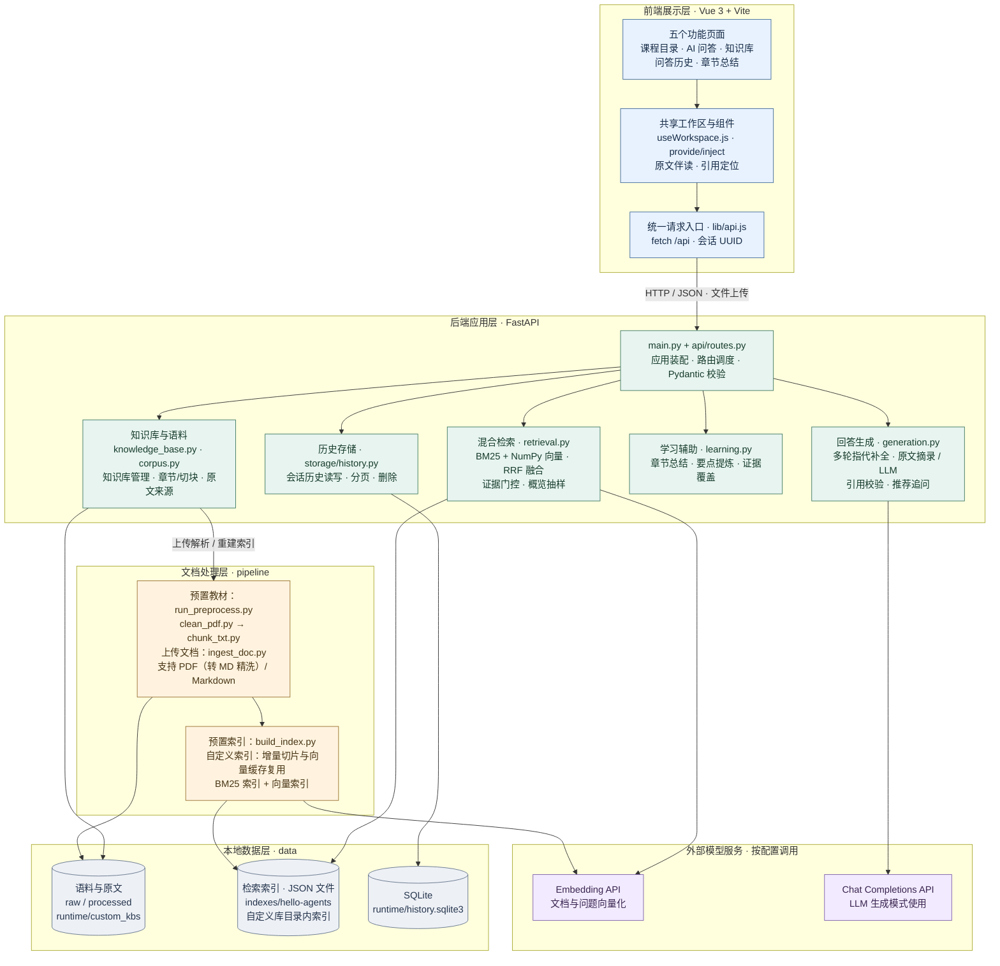

# 知序 · 项目结构图

核对日期：2026-11-28。依据当前源码与本地目录整理，未修改业务代码。

## 系统架构

项目采用 **Vue 3 前端 + FastAPI 单体后端 + 本地文件索引 + SQLite 历史存储**，提供课程与个人文档的混合检索增强问答、原文伴读、章节总结。


箭头表示调用或读写依赖，不是严格执行时序。后端服务处于同一应用内，不是独立微服务。向量检索使用 NumPy，索引保存为 JSON 文件，不是独立向量数据库。

## 目录职责

以下路径相对于项目根目录 F:/桌面/毕设，省略依赖、缓存与临时文件。

```text
毕设/
├─ frontend/                         Vue 3 + Vite 前端
│  ├─ src/
│  │  ├─ main.js                     浏览器入口
│  │  ├─ App.vue                     页面装配、共享工作区注入
│  │  ├─ views/
│  │  │  ├─ OverviewView.vue         课程目录
│  │  │  ├─ QuestionView.vue         AI 问答与双栏原文伴读
│  │  │  ├─ KnowledgeView.vue        知识库与上传文档管理
│  │  │  ├─ HistoryView.vue          问答历史
│  │  │  └─ SummaryView.vue          章节总结
│  │  ├─ components/                 布局、范围选择、引用
│  │  ├─ composables/useWorkspace.js 跨页共享状态与操作
│  │  ├─ lib/                        API 请求与展示辅助函数
│  │  └─ styles/                     页面及组件样式
│  ├─ test/                          前端测试
│  └─ vite.config.js                构建及开发代理配置
├─ backend/                          FastAPI 后端
│  ├─ main.py                       应用装配、生命周期、跨域与错误处理
│  ├─ config.py                     路径、模型及运行模式配置
│  ├─ errors.py                     业务异常
│  ├─ api/routes.py                 HTTP 路由及业务编排
│  ├─ schemas/models.py             请求与响应模型
│  ├─ services/
│  │  ├─ corpus.py                  预置语料读取与来源查询
│  │  ├─ knowledge_base.py          多知识库、文档上传、增量索引构建
│  │  ├─ retrieval.py               BM25 / 向量 / RRF 融合与门控
│  │  ├─ generation.py              查询改写、回答生成、引用校验
│  │  └─ learning.py                章节总结
│  └─ storage/history.py            SQLite 会话历史
├─ pipeline/                         文档处理与索引工具
│  ├─ run_preprocess.py             预置教材预处理总入口
│  ├─ clean_pdf.py                  PDF 正文提取与清洗
│  ├─ chunk_txt.py                  保留章节及页码的文本切块
│  ├─ ingest_doc.py                 上传 PDF（转 MD 精洗）/ Markdown 解析
│  └─ build_index.py                预置语料索引构建
├─ data/
│  ├─ raw/                          原始资料目录
│  ├─ processed/hello-agents/       预置课程章节、文本块、处理报告
│  ├─ indexes/hello-agents/         预置 BM25 / 向量索引与清单
│  ├─ runtime/
│  │  ├─ history.sqlite3            问答历史数据库
│  │  ├─ custom_kbs/                自定义库原文、语料及索引
│  │  └─ textbooks/                 运行时教材目录
│  └─ evaluation/                  检索评测数据
├─ tests/                            后端、预处理与检索测试
├─ tools/                            检索评测、接口冒烟、契约导出等
├─ docs/                             接口、预处理、产品与论文文档
├─ requirements.txt                  Python 依赖
└─ README.md                         项目说明与启动入口
```

## 核心业务关系

- **问答**：问答页 → API → 定位知识库、读取近期会话 → 指代补全 → 混合检索与证据门控 → 原文摘录或模型回答 → 校验响应并写入 SQLite → 展示回答、引用及原文定位。
- **上传**：知识库页 → 知识库管理服务 → 解析文件（PDF 转 MD 精洗跳过目录/习题）→ 增量复用已有切片与向量缓存 → 更新自定义知识库。
- **学习辅助**：总结页 → API → LearningService 选取章节材料 → 本地生成或调用模型 → 返回结果与引用。
- **原文伴读**：PDF 页面由后端 pypdfium2 渲染为图片，前端负责预览与引用定位；非 PDF 文档可浏览正文切片。

前端使用 provide/inject 共享工作区及 KeepAlive 保留切页状态。Embedding 用于建索引及问题向量化；Chat Completions 在 LLM 生成模式下使用。

## 源码依据

- [后端装配](F:/桌面/毕设/backend/main.py)
- [路由与问答编排](F:/桌面/毕设/backend/api/routes.py)
- [前端页面装配](F:/桌面/毕设/frontend/src/App.vue)
- [混合检索实现](F:/桌面/毕设/backend/services/retrieval.py)
- [知识库管理](F:/桌面/毕设/backend/services/knowledge_base.py)
- [学习辅助](F:/桌面/毕设/backend/services/learning.py)

本图描述静态代码结构；外部模型连通性不由本图保证。README 中规划的 SSE 未纳入已实现架构。

## 制图说明

- 目的与读者：帮助项目阅读者理解模块分层、依赖与数据存储。
- 图型：分组流程图展示关系，目录树补充物理布局；单一线性列表难以表达共享依赖。
- 节点清单：前端页面/工作区/请求入口，后端 API/知识库/检索/生成/学习/历史，文档解析/索引，语料/索引文件/数据库，Embedding/LLM；共 16 个节点。
- 通过分组、文字与圆柱形存储节点区分职责，不只依赖颜色。
- [可编辑 Mermaid 图源](F:/桌面/毕设/docs/architecture/project-structure.mmd)
- [矢量 SVG](F:/桌面/毕设/docs/architecture/project-structure.svg)

## Mermaid 图源


