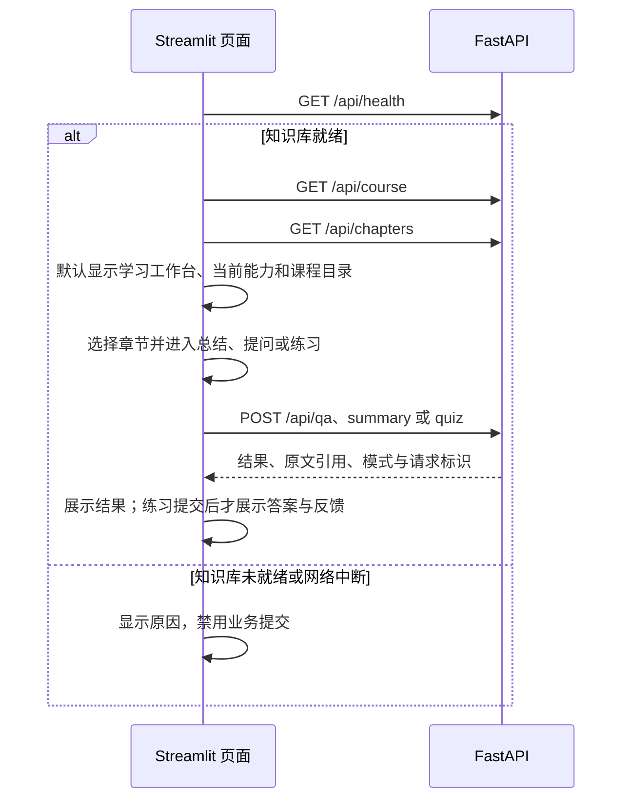

# 前端接口接入文档

更新日期：2026-10-25。适用当前 Streamlit 前端与 FastAPI `/api` 接口。

## 1. 运行与边界

前端与后端是两个独立进程。Streamlit 收集输入，通过 `httpx` 请求 FastAPI；前端不导入后端服务、不直接读取语料或数据库。浏览器显示 Streamlit 页面；教材 PDF 链接由浏览器直接打开后端地址。

## 中文界面约定

学习页面使用最简工具栏，不展示框架自带的英文部署弹窗入口或开发菜单。检索方式显示“关键词检索 / 向量检索 / 混合检索”，接口仍发送 `bm25 / vector / hybrid`。覆盖统计、复核标记、耗时、文件阅读按钮和空选择提示均使用中文。

固定模式提示中的内部英文枚举只在展示时转为中文，兼容旧问答历史，不修改原始响应或历史存储。教材引文、课程专名、引用编号及排查用编号保持原文，保证出处可核对。

```powershell
# 终端一：在项目根目录启动后端
Set-Location 'F:/桌面/毕设'
& 'F:/桌面/毕设/.venv/Scripts/python.exe' -m uvicorn backend.main:app --host 127.0.0.1 --port 8000

# 终端二：启动前端
Set-Location 'F:/桌面/毕设'
$env:BACKEND_URL = 'http://127.0.0.1:8000'
$env:BACKEND_TIMEOUT = '90'
& 'F:/桌面/毕设/.venv/Scripts/python.exe' -m streamlit run 'F:/桌面/毕设/frontend/app.py'
```

| 配置 | 默认值 | 说明 |
|---|---|---|
| `BACKEND_URL` | `http://127.0.0.1:8000` | 后端根地址，不附加 `/api`；支持反向代理路径前缀 |
| `BACKEND_TIMEOUT` | `90` 秒 | HTTP 超时；有效范围大于 0 且不超过 600，无效值回退 90 |

前端从 `frontend/api_client.py` 的文件位置定位项目根目录，并从根目录 `.env` **仅加载上述两个前端配置项**；不依赖启动时所在目录，现有进程环境变量优先，不加载模型配置或密钥。也可以直接在启动终端设置这两个环境变量，示例如上。

`BACKEND_URL` 应同时可被 Streamlit 进程和访问页面的浏览器访问。远程部署时，浏览器中的 `127.0.0.1` 指向访问者自己的设备；应改为后端公开服务地址。HTTP 客户端不自动重试 POST，避免重复生成和重复写入历史。API 密钥仅配置在后端，不传给前端。

客户端自己创建连接池时，`localhost`、`127.0.0.0/8` 和 `::1` 等回环地址使用 `trust_env=False`，直接连接本机后端，避免 Windows 隐式系统代理将本地请求转发出去；其他后端地址保留 `trust_env=True`，继续支持正常代理环境。注入 `client=` 时不改变调用者已配置的代理行为或连接池生命周期。

## 2. 文件与职责

| 文件 | 职责 |
|---|---|
| [frontend/app.py](F:/桌面/毕设/frontend/app.py) | 页面导航、当前会话提示 |
| [frontend/api_client.py](F:/桌面/毕设/frontend/api_client.py) | HTTP 方法、统一异常、超时、固定 PDF URL |
| [frontend/components/ui.py](F:/桌面/毕设/frontend/components/ui.py) | APIClient 缓存、会话 UUID、章节小节选择、引用和结果元数据 |
| [frontend/pages/overview.py](F:/桌面/毕设/frontend/pages/overview.py) | 默认学习工作台、课程目录、当前能力和连续学习入口 |
| [frontend/pages/qa.py](F:/桌面/毕设/frontend/pages/qa.py) | 检索问答 |
| [frontend/pages/summary.py](F:/桌面/毕设/frontend/pages/summary.py) | 章节/小节总结 |
| [frontend/pages/quiz.py](F:/桌面/毕设/frontend/pages/quiz.py) | 练习生成与自测 |
| [frontend/pages/history.py](F:/桌面/毕设/frontend/pages/history.py) | 当前会话历史查询、分页、删除 |

## 3. APIClient 方法表

成功响应解析为 Python `dict`；单条删除为 `None`。失败统一抛出 `APIError`。所有调用只接受业务字段，不接受任意目标 URL。

| 方法 | HTTP 接口 | 输入/用途 |
|---|---|---|
| `health()` | `GET /api/health` | 检查知识库、生成配置、历史存储状态 |
| `course()` | `GET /api/course` | 课程名、数据版本、覆盖信息、文本块数量 |
| `chapters()` | `GET /api/chapters` | 返回 `{course_id,dataset_version,chapters}` |
| `chapter(chapter_id)` | `GET /api/chapters/{chapter_id}` | 指定章节详情和小节目录 |
| `source(chunk_id)` | `GET /api/sources/{chunk_id}` | 指定原文证据及页码 |
| `ask(payload)` | `POST /api/qa` | 问答并保存历史 |
| `summarize(payload)` | `POST /api/summary` | 章/节摘要及覆盖统计 |
| `quiz(payload)` | `POST /api/quiz` | 练习题、答案、解析、引用 |
| `history(session_id,limit=20,offset=0)` | `GET /api/history` | 必传当前会话 UUID；页面实际每页 10 条 |
| `history_item(record_id,session_id)` | `GET /api/history/{record_id}` | 当前会话的单条问答 |
| `delete_history_item(record_id,session_id)` | `DELETE /api/history/{record_id}` | 成功为 HTTP 204 |
| `clear_history(session_id)` | `DELETE /api/history` | 返回 `{deleted: 数量}` |
| `pdf_url(page)` | 构造 `/api/course/source#page=N` | 不发出 HTTP；`page` 必须为正整数 |

历史操作的 `session_id`、`limit`、`offset` 均在 query 参数中；JSON body 只用于三个 POST 接口。所有路由标识符按 URL 路径片段编码。

## 4. 三类提交契约

### 4.1 智能问答

```json
{
  "question": "什么是智能体？",
  "chapter_id": "ch01",
  "section_id": "ch01-s001",
  "session_id": "d7d96af0-8afb-4d73-8bf2-213031cd9fea",
  "retrieval_mode": "bm25",
  "top_k": 5
}
```

- `question`：去除两端空白后 1—2000 字符；页面阻止空问题。
- `chapter_id`、`section_id`：可为 `null`，章节编号形如 `ch01`，小节编号形如 `ch01-s001`；页面使用后端返回的目录值，不自行猜测。
- `session_id`：页面始终传入同一浏览器会话的随机 UUID。
- `retrieval_mode`：`bm25`、`vector`、`hybrid`；页面仅显示健康接口提供的已就绪模式。正常默认配置使用真实 BM25。
- `vector/hybrid` 当前属于实验能力；即使索引就绪，页面也提示课程外问题拒答尚未独立校准。BM25 种子门控结果不能代表其他模式。
- `top_k`：1—10，默认 5；可选 `debug` 默认 `false`，页面不主动启用。

响应使用 `answer` 渲染回答，`citations` 渲染证据，`insufficient_evidence` 控制证据不足提示。其余字段为 `retrieval_mode`、`generation_mode`、`scope`、`dataset_version`、`latency_ms`、`request_id`、`session_id`、`history_id`、`debug`。

### 4.2 总结

```json
{"chapter_id": "ch01", "section_id": null}
```

章节必选，小节可选。响应包含 `summary`、`key_points`、`citations`、`coverage`、`generation_mode` 和公共元数据 `scope/dataset_version/latency_ms/request_id`。页面展开显示覆盖统计；代表性证据摘要不被标为覆盖全章全部知识点。

### 4.3 练习

```json
{
  "chapter_id": "ch01",
  "section_id": null,
  "count": 5,
  "question_types": ["short_answer", "multiple_choice"],
  "difficulty": "medium"
}
```

- `count`：整数 1—10，默认 5。
- `question_types`：至少一种，支持 `short_answer`（简答）、`multiple_choice`（单选），不可重复。
- `count` 不得小于所选题型数量；页面在发送 HTTP 请求前检查这一条件。
- `difficulty`：`easy/medium/hard` 对应基础/中等/进阶。它是生成要求，不是经评测的难度等级。
- 每题字段：`question_id/type/question/options/answer/explanation/citation_ids`；`options` 中每项为 `{key,text}`。
- 响应同时返回 `citations/generation_mode` 及公共元数据。选项默认不选；页面把作答保存在当前 Streamlit 会话中，全部完成并点击“提交本次作答”前不创建答案与解析控件。
- 提交后，单选题按答案键显示客观结果；简答题只显示完成情况、参考答案和自评提示，不进行未经验证的语义自动判分。
- 提交时保存本轮作答快照并锁定输入，页面重跑不会改变已经提交的分数。学习者可以标记“已掌握/待复习”，重做待复习题或显式开始本组新一轮作答。
- 答案已经存在 HTTP 响应和当前页面会话中，因此该交互只用于学习自测，不是考试安全或服务端答案保密方案。

## 5. 页面调用顺序与状态



历史页独立调用 `/api/history`，不以教材是否就绪为前提。清空历史需要勾选确认；单条删除按记录 ID 和当前会话 UUID 执行。删除后页面重新查询，避免显示旧记录。

每次页面重新执行均刷新就绪状态与课程目录；APIClient 连接池被缓存，业务结果不做全局缓存。默认页面是“学习工作台”；它展示当前检索/生成能力、12 章目录以及“总结—提问—练习—回顾”四步路径。首页选择章节后，目标页复用对应章选择。提交成功的结果仅保存在当前 Streamlit 会话中，其他浏览器会话不共享问答页面状态。问答检索方式的初始选项采用健康接口返回的 `default_retrieval_mode`（该模式可用时），之后保留用户选择。

结果元数据显示响应中的实际 `scope`，用户修改筛选器后仍能区分当前显示的是上一次生成结果。练习重新生成后使用新的作答控件标识，清除旧题的作答和提交状态；未答完时答案继续隐藏。历史清空成功后将页码重置为 1，并取消清空确认；历史页以 session state 为页码唯一初始值来源，避免控件默认值冲突警告。

## 6. 会话、引用与生成方式

**会话**：首次进入时生成 `uuid4()` 并存入 `st.session_state['session_uuid']`；四页共享。后端历史存储按此 UUID 查询和删除。刷新、断线重连或结束 Streamlit 会话可能生成新的 UUID；这不是账号登录或持久的用户身份。历史只记录问答，总结/练习不进入问答历史。

**引用**：显示 `citation_id`、原文 `text`、章/节标题、`source_file`、`chunk_id`、PDF 物理页码、抽取复核标记。引用编号对应答案中的 `[N]`。PDF 从 1 开始计页，不是书内印刷页码。只有证据声明 `source_url` 可用时显示跳转按钮；跳转目标仍严格从配置的 `BACKEND_URL` 和正整数页码构造，忽略响应中任意外部 URL。

**生成方式**：`generation_mode=extractive` 明确显示“教材原文摘录（本地抽取式，未调用大模型）”；`llm` 显示“大模型依据教材证据生成”。前端不把本地摘录包装成模型回答。

## 7. 错误处理

后端错误格式：

```json
{
  "error": {"code": "VALIDATION_ERROR", "message": "请求参数校验失败。", "details": []},
  "request_id": "可用于排查的请求标识"
}
```

`APIError` 属性为 `message/code/status_code/request_id/details`。页面显示 `message` 和 `request_id`，不展示网络原始异常或服务器 HTML。优先读取 `X-Request-ID` 响应头，缺失时使用 JSON 中的请求标识。

| 情况 | 页面行为 |
|---|---|
| 后端连接中断 | 显示启动 FastAPI、检查 `BACKEND_URL` 的提示 |
| 请求超时 | 显示稍后重试、检查后端模型服务的提示 |
| 404 | 提示章节、原文或历史记录不存在 |
| 422 | 提示输入校验问题 |
| 502/503/504 | 展示后端统一错误消息，不把失败伪装为成功结果 |
| 成功状态但响应不是 JSON object | 显示服务版本/响应格式异常 |

## 8. 可复用接入示例与测试

```python
from uuid import uuid4
from frontend.api_client import APIClient, APIError

session_id = str(uuid4())
with APIClient("http://127.0.0.1:8000", timeout=90) as api:
    try:
        result = api.ask({
            "question": "智能体如何与环境交互？",
            "chapter_id": "ch01",
            "session_id": session_id,
            "retrieval_mode": "bm25",
            "top_k": 5,
        })
        print(result["answer"])
        print(api.history(session_id)["total"])
    except APIError as error:
        print(error.message, error.request_id)
```

构造器支持 `client=httpx.Client(...)` 或 `transport=httpx.MockTransport(...)`；二者互斥。注入已有 client 时，生命周期由调用者管理；APIClient 不关闭调用者的连接池。

```powershell
Set-Location 'F:/桌面/毕设'
& 'F:/桌面/毕设/.venv/Scripts/python.exe' -m unittest tests.test_frontend_client tests.test_frontend_pages tests.test_frontend_live -v
```

前端测试覆盖客户端路由、参数、超时、错误信封、`.env` 加载与环境变量优先级、回环地址代理绕过、五页执行、首页课程目录、章/节联动、问答引用与 PDF URL、练习提交前隐藏答案、提交反馈、重新生成清除旧作答、会话隔离、历史删除/清空和离线降级。

`tests/test_frontend_live.py` 用真实合成 PDF 执行生产预处理，经生产 BM25、抽取式生成和 SQLite 完成四页联调；只在测试层把 FastAPI `TestClient` 注入 `APIClient(client=...)`，生产前端仍只有 HTTP 依赖。此联调在 ASGI 内存传输中执行，不等同于浏览器或真实端口测试。上述测试不调用外部模型，也不要求先启动服务器。
