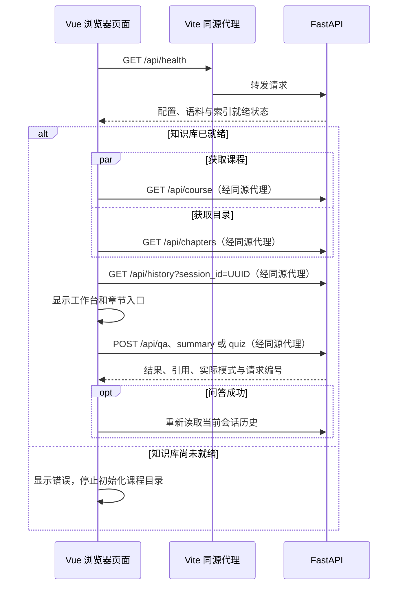

# Vue 前端接口接入文档

更新：2026-11-05。适用当前 Vue 3 工作台与 FastAPI `/api` 接口；描述以实际源码为准。

先读[项目运行流程](F:/桌面/毕设/docs/project-runtime-flow.md)建立全局认识，再按本文定位页面、请求和状态。Vue 组件及样式结构见[前端说明](F:/桌面/毕设/frontend/README.md)，完整响应字段见[后端接口文档](F:/桌面/毕设/docs/api-reference.md)。

## 1. 运行方式与职责边界

浏览器运行 Vue 页面，页面通过原生 `fetch` 请求同源 `/api`。开发和本地构建预览由 Vite 转发到 FastAPI；正式部署由 Web 服务配置相同的反向代理。前端不导入 Python 服务、不直接读取教材数据或 SQLite。

```powershell
# 终端一：启动后端
Set-Location 'F:/桌面/毕设'
& 'F:/桌面/毕设/.venv/Scripts/python.exe' -m uvicorn backend.main:app --host 127.0.0.1 --port 8000

# 终端二：启动 Vue 前端
Set-Location 'F:/桌面/毕设/frontend'
npm ci
npm run dev
```

前端地址：[http://127.0.0.1:5173](http://127.0.0.1:5173)。需要 Node.js 20.19+ 或 22.12+；Python 依赖见 [requirements.txt](F:/桌面/毕设/requirements.txt)，前端依赖见 [package.json](F:/桌面/毕设/frontend/package.json)。`npm ci` 用于安装锁文件中的依赖，不必在每次启动时重复执行。

| 配置 | 当前实现 |
|---|---|
| 后端代理地址 | 默认 `http://127.0.0.1:8000`；在启动 Vite 的终端设置 `BACKEND_URL`，或在 `F:/桌面/毕设/frontend/.env.local` 配置该项 |
| 浏览器请求路径 | 固定同源 `/api`；页面不直接拼接后端主机地址 |
| 请求超时 | `request()` 默认 `90000` 毫秒，可通过其 `timeout` 参数按请求调整；Vue 请求层不读取 `BACKEND_TIMEOUT` |
| 模型配置 | 仅服务端读取；Vite 配置只加载后端代理地址，不把模型密钥传入浏览器 |

[Vite 配置](F:/桌面/毕设/frontend/vite.config.js)同时为开发服务器和本地预览配置代理。常规本地开发走同源请求，无需调整后端 CORS；如果改为浏览器直连不同源后端，再按实际来源配置 `CORS_ORIGINS`。生产环境需独立配置 `/api` 反向代理，Vite 开发代理不是生产服务器。

## 2. 文件与职责

| 文件 | 职责 |
|---|---|
| [浏览器入口](F:/桌面/毕设/frontend/src/main.js) | 创建 Vue 应用并加载样式 |
| [App.vue](F:/桌面/毕设/frontend/src/App.vue) | 公共布局、页面装配、工作区生命周期、页面缓存 |
| [useWorkspace.js](F:/桌面/毕设/frontend/src/composables/useWorkspace.js) | 课程、章/节范围、会话 UUID、历史快照、初始化和公共提示 |
| [api.js](F:/桌面/毕设/frontend/src/lib/api.js) | `fetch`、超时、错误、会话 UUID、分页路径和单选计分 |
| [QuestionView.vue](F:/桌面/毕设/frontend/src/views/QuestionView.vue) | 问题输入、返回证据数、问答结果与引用 |
| [SummaryView.vue](F:/桌面/毕设/frontend/src/views/SummaryView.vue) | 章/节总结、要点及证据覆盖 |
| [QuizView.vue](F:/桌面/毕设/frontend/src/views/QuizView.vue) | 生成、作答、提交、计分、自评和重做 |
| [HistoryView.vue](F:/桌面/毕设/frontend/src/views/HistoryView.vue) | 刷新、分页、单条删除与确认清空 |
| [ScopeSelector.vue](F:/桌面/毕设/frontend/src/components/ScopeSelector.vue) | 共享章/节选择；问答可不限章节，总结和练习必须选章 |
| [SourceList.vue](F:/桌面/毕设/frontend/src/components/SourceList.vue) | 展开教材证据、章/节和 PDF 物理页码，并打开原 PDF |

## 3. 请求封装与接口映射

页面调用 `request(path, { method, body, timeout })`。`path` 以 `/` 开头且不含 `/api` 前缀，例如 `request('/health')` 实际请求 `/api/health`。成功返回 JavaScript 对象；删除成功的 HTTP 204 返回 `null`；失败抛出普通 `Error`，由页面展示 `error.message`。

| 调用路径 | HTTP 方法 | 用途 |
|---|---|---|
| `/health` | GET | 知识库、默认检索、生成配置与历史存储状态 |
| `/course` | GET | 固定课程和语料版本 |
| `/chapters`、`/chapters/{chapter_id}` | GET | 已入库章/节目录与指定章详情 |
| `/sources/{chunk_id}` | GET | 指定证据块；当前引用组件直接使用业务响应中的 `citations` |
| `/qa` | POST | 检索问答并保存历史 |
| `/summary` | POST | 章/节总结及覆盖统计 |
| `/quiz` | POST | 练习、答案、解析和引用 |
| `/history?session_id=UUID&limit=10&offset=0` | GET | 当前会话历史；`historyPath()` 统一生成分页参数 |
| `/history/{record_id}?session_id=UUID` | GET / DELETE | 单条历史契约；页面删除时对记录 ID 编码 |
| `/history?session_id=UUID` | DELETE | 清空当前会话，返回 `{deleted: 数量}` |

历史查询、删除的会话与分页参数位于 query；三个 POST 的业务数据放入 JSON body。页面不会自动重试 POST，避免重复生成或写入历史。

## 4. 三类提交契约

### 4.1 问答

```json
{
  "question": "什么是智能体？",
  "chapter_id": "ch01",
  "section_id": "ch01-s001",
  "session_id": "d7d96af0-8afb-4d73-8bf2-213031cd9fea",
  "retrieval_mode": "hybrid",
  "top_k": 5
}
```

- `question`：去除两端空白后 1—2000 字符；页面拦截空输入。
- `chapter_id`、`section_id`：可为 `null`，页面使用接口目录返回的标识。两者均为空表示检索本教材全部已入库内容，不表示切换课程。
- `session_id`：页面始终传入当前标签页复用的 UUID。
- `retrieval_mode`：页面固定采用健康接口的 `default_retrieval_mode`，缺值时按 `hybrid` 发送；不提供检索方式切换。API 保留 `bm25/vector/hybrid` 供显式调用和评测。
- `top_k`：默认 5，允许 1—10；页面可调整返回证据数。可选 `debug` 默认 `false`，页面不主动启用。

页面读取 `answer`、`citations`、`insufficient_evidence`、实际检索/生成方式、耗时和数据版本。证据不足是可展示的业务结果；服务未就绪或上游调用失败是错误，两者不混同。

### 4.2 总结

```json
{"chapter_id": "ch01", "section_id": null}
```

章节必选，小节可选。响应包含 `summary`、`key_points`、`citations`、`coverage`、`generation_mode` 和公共元数据。`coverage` 说明实际选取的代表性证据范围，不表示逐字覆盖所有知识点。

### 4.3 练习

```json
{
  "chapter_id": "ch01",
  "section_id": null,
  "count": 5,
  "question_types": ["short_answer", "multiple_choice"],
  "difficulty": "medium"
}
```

- `count`：整数 1—10，默认 5。
- `question_types`：至少一种，支持 `short_answer`（简答）、`multiple_choice`（单选），不可重复；题数至少等于所选题型数。
- `difficulty`：`easy/medium/hard` 对应基础/中等/进阶，是生成要求，不是实测难度等级。
- 每题字段为 `question_id/type/question/options/answer/explanation/citation_ids`；选项为 `{key,text}`。响应还包含 `citations/generation_mode` 和公共元数据。
- 用户作答保存在 Vue 页面内存中。全部完成并提交之前，不渲染参考答案、解析和教材引用；答案本身已随 HTTP 响应返回，该交互用于学习自测。
- 提交后锁定本轮输入，单选题按选项键客观计分；简答题展示参考答案，由学习者标记“已掌握/待复习”。
- 支持整组重答，或仅重做答错的单选题与标记“待复习”的简答题；重新生成题组会清空旧作答、自评和提交状态。
- 自测题由教材知识内容组织，不是把教材中已排除的课后练习重新入库。

## 5. 调用顺序与页面状态



`init()` 在应用挂载及用户点击“重新连接”时执行，不会在每次页面切换时重跑。网络或请求错误会显示中文提示；业务提交还要求知识库、生成配置和默认检索模式就绪。健康检查不探测远程模型连通性，实际请求仍可能因上游异常失败。

`App.vue` 用 `provide/inject` 共享工作区，用 `KeepAlive` 保留已访问页面。地址中的 `#qa`、`#quiz` 等决定当前页面；没有引入 Vue Router 或 Pinia。章/节范围改变时，各学习页面主动清除旧结果，避免上一章内容留在新范围中。

历史页每次激活会刷新列表；单条删除先进入确认态，清空则需勾选确认。删除后重新查询；清空后页码归零，并通知问答页清除旧回答。历史接口可按会话独立读取，不要求重新生成答案。

## 6. 哪些状态会保留

| 状态 | 切换页面后 | 刷新浏览器后 |
|---|---|---|
| 会话 UUID | 复用 | 从 `sessionStorage` 的 `zhixu-session` 读取并复用 |
| 问答历史 | 从后端按 UUID 读取 | 初始化时重新读取 SQLite 中的同会话记录 |
| 当前输入、回答、总结、题组、作答和自评 | 已访问页面由 `KeepAlive` 保留；范围改变会清除旧结果 | 不恢复，这些状态仅在 Vue 内存中 |
| 页面位置 | 使用 URL hash | 按有效 hash 恢复页面；章/节选择重新初始化 |

UUID 由 `crypto.randomUUID()` 生成，不是登录账号。其保留范围由浏览器标签页会话存储决定；SQLite 只持久化问答，不持久化总结、练习作答、学习进度或错题复习记录。

## 7. 教材引用与生成方式

引用组件使用普通文本插值显示 `text`，不执行教材内容中的 HTML。标题显示小节或章名、引用编号、PDF 物理页范围；点击可展开原文。引用字段中的来源文件、块 ID、复核标记保留在 API 数据中，当前卡片并未全部展示。

只有 `source_url` 非空时才显示 PDF 入口，但实际链接固定构造为同源 `/api/course/source#page=page_start`，不直接使用任意响应地址。页码从 PDF 第一页起算，浏览器阅读器处理 `#page`；打开的是完整原 PDF，并非只含知识正文的裁剪文件。

`generation_mode=extractive` 显示为原文摘录，`llm` 显示为模型依据教材生成；页面显示响应的实际模式，不把配置字段当作模型已成功调用的证据。

## 8. 错误处理与接入示例

后端失败返回 `{error: {code, message, details?}, request_id}`，同时附 `X-Request-ID`。请求层优先从响应头读取请求编号，缺失时取 JSON 字段，并把编号合并到普通 `Error.message` 中；页面不依赖已移除的 Python 客户端异常类。

| 情况 | 当前行为 |
|---|---|
| HTTP 204 | 直接返回 `null`，不解析 JSON |
| 非成功状态 | 展示后端消息与可用请求编号；非 JSON 错误体使用通用消息 |
| 超时 | `AbortController` 中止请求，显示“请求超时，请稍后重试。” |
| 网络连接中断 | 显示“连接中断，请确认后端服务已启动。” |
| 成功响应不是 JSON 对象 | 显示“服务响应格式异常。” |

下面片段供前端模块使用；运行方式以本项目 Vite 工程为准：

```javascript
import { request, sessionId } from "./api.js";

const health = await request("/health");
const result = await request("/qa", {
  method: "POST",
  body: {
    question: "智能体如何与环境交互？",
    chapter_id: "ch01",
    session_id: sessionId(),
    retrieval_mode: health.default_retrieval_mode,
    top_k: 5,
  },
});
console.log(result.answer);
```

示例假定代码放在 [lib 目录](F:/桌面/毕设/frontend/src/lib)的相邻模块中；真实页面调用参见 [QuestionView.vue](F:/桌面/毕设/frontend/src/views/QuestionView.vue)。

## 9. 测试与验收的区别

```powershell
Set-Location 'F:/桌面/毕设/frontend'
npm test
npm run build
```

`npm test` 使用 Node 内置测试运行器执行请求、会话、工作区、组件结构与样式测试；`npm run build` 检查 Vue 生产构建。测试位置为 [frontend/test](F:/桌面/毕设/frontend/test)。这些命令不等于已完成真实浏览器、真实模型与真实后端的全过程验收。

后端测试在项目根目录执行 `F:/桌面/毕设/.venv/Scripts/python.exe -B -m unittest discover -s tests -v`。模型异常可在测试中用模拟传输复现；真实服务连通、刷新恢复、会话隔离和学习至复习的完整流程，应另留浏览器与联调证据。
