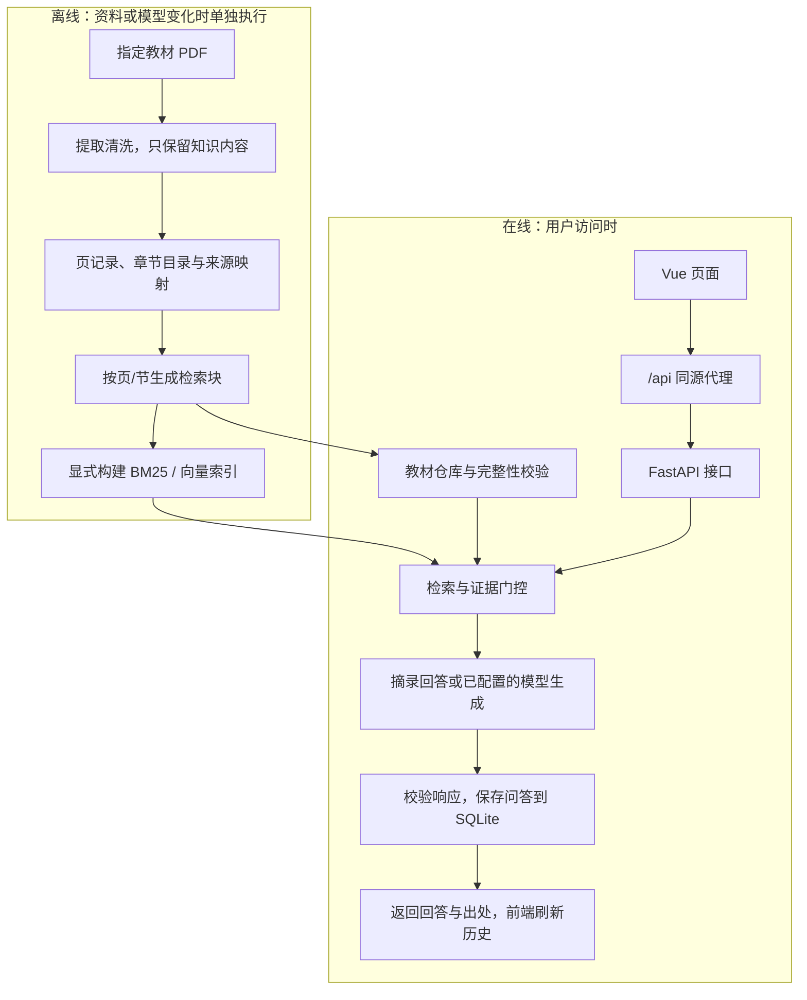

# 项目运行流程与阅读路线

更新：2026-11-05。本文按当前源码核对，说明系统怎样运行、先读什么文件；不把接口存在、配置就绪或任务书目标当作整链路已验收。总入口见 [README](F:/桌面/毕设/README.md)，目录见 [项目目录](F:/桌面/毕设/目录.md)。

## 一、先用一句话理解项目

这是一个围绕 Hello-Agents 教材的单课程学习助手：Vue 收集输入，FastAPI 调用教材检索和学习服务，返回回答、总结或阅读自测，SQLite 只保存当前会话的问答历史。

| 部分 | 负责什么 | 先看哪里 |
|---|---|---|
| Vue 前端 | 五个页面、章/节选择、结果和来源展示 | [App.vue](F:/桌面/毕设/frontend/src/App.vue) |
| HTTP 接口 | 校验输入、调度服务、组织响应 | [routes.py](F:/桌面/毕设/backend/api/routes.py) |
| 教材仓库 | 校验文件、提供目录、按范围取知识块 | [corpus.py](F:/桌面/毕设/backend/services/corpus.py) |
| 检索 | BM25、向量召回、RRF 融合与证据门控 | [retrieval.py](F:/桌面/毕设/backend/services/retrieval.py) |
| 回答/学习服务 | 摘录或模型生成、总结与自测 | [generation.py](F:/桌面/毕设/backend/services/generation.py)、[learning.py](F:/桌面/毕设/backend/services/learning.py) |
| 存储 | 按会话 UUID 保存、查询和删除问答 | [history.py](F:/桌面/毕设/backend/storage/history.py) |

## 二、系统总图：离线处理与在线使用分开



普通启动只加载已有资料和索引，不重做清洗、不自动建向量索引、不主动调用模型。总结和自测走学习服务，不写入上述问答历史。

当前语料为第 1—12 章、67 节、759 块，PDF 物理页 10—560；规模与来源以 [预处理报告](F:/桌面/毕设/data/processed/hello-agents/report.json) 为准。第 13—15 章知识内容是后续扩展目标，不是当前已入库。原 PDF 从报告或 SOURCE_PDF 配置定位，来源接口返回完整原 PDF；知识库过滤不会改写原 PDF。

## 三、一次问答怎样从页面走到数据库

以“ReAct 的核心流程是什么？”为例，下表是调用顺序，不是本轮执行得到的答案或检索成绩。

| 顺序 | 实际入口 | 输入、动作和输出 |
|---|---|---|
| 1 | [QuestionView.vue](F:/桌面/毕设/frontend/src/views/QuestionView.vue) 的 ask | 读取问题、章/节范围、会话 UUID、返回证据数；检索模式采用健康接口返回的默认值 |
| 2 | [api.js](F:/桌面/毕设/frontend/src/lib/api.js) 的 request | fetch 向 /api/qa 提交 JSON；默认 90 秒超时，失败显示错误 |
| 3 | [routes.py](F:/桌面/毕设/backend/api/routes.py) 的 question_answer | 按 [models.py](F:/桌面/毕设/backend/schemas/models.py) 校验请求，先确认历史存储可用，再调检索 |
| 4 | [retrieval.py](F:/桌面/毕设/backend/services/retrieval.py) 的 search | 先按章/节过滤，再召回、排序和检查证据，形成带页码的引用 |
| 5 | [generation.py](F:/桌面/毕设/backend/services/generation.py) 的 answer | extractive 摘取教材原文；llm 调用配置的生成模型；证据不足时返回相应说明 |
| 6 | [routes.py](F:/桌面/毕设/backend/api/routes.py) 与 [history.py](F:/桌面/毕设/backend/storage/history.py) | 校验 QAResponse 后调用 HistoryStore.add，保存问答再返回；模型输出错误不会保存为成功记录 |
| 7 | [QuestionView.vue](F:/桌面/毕设/frontend/src/views/QuestionView.vue) 与 [SourceList.vue](F:/桌面/毕设/frontend/src/components/SourceList.vue) | 展示回答、来源与实际模式，刷新共享问答历史 |

章、节都为空时，检索范围是全部已入库内容，可跨章召回；当前仍只有第 1—12 章。总结和自测要求选章。一次召回命中多章，不等于答案已通过跨章推理质量评阅。

## 四、两个模式开关分别控制什么

| 配置 | 代码默认值 | 含义与依赖 |
|---|---|---|
| DEFAULT_RETRIEVAL_MODE | hybrid | BM25 与真实 Embedding 向量召回，经 RRF 融合；需要匹配语料/模型的索引和可用的 Embedding 服务 |
| GENERATION_MODE | extractive | 按教材证据摘录，不调用生成模型；改为 llm 后另需配置生成服务 |

默认值来自 [config.py](F:/桌面/毕设/backend/config.py)，环境覆盖会改变实际模式。检索与生成是独立配置：extractive 不调用生成模型，但 hybrid 仍需问题向量，不能据此理解为完全离线。

健康检查核对本地语料、索引、配置与历史存储，不主动探测模型服务连通性。配置与索引显示就绪，真实请求仍可能因上游断开、超时或无效输出返回 502/504；缺数据、索引或必要配置时返回 503。系统不静默改用另一种检索模式。

## 五、总结、自测、历史怎样衔接

- 总结：SummaryView 提交章/节，LearningService.summary 选取代表性证据，返回总结、要点和 coverage；代表性摘要不等于逐条覆盖整章。
- 自测：QuizView 提交范围、数量、题型和难度，LearningService.quiz 返回题目、答案、解析和引用。提交作答后才展示答案；单选客观计分，简答参考答案自评。它是从知识块生成的阅读自测，不是导入教材课后题。
- 历史：只有问答进入 SQLite，查询和删除均携带 session_id。当前没有账号、长期学习进度或持久化错题复习闭环。

状态入口见 [useWorkspace.js](F:/桌面/毕设/frontend/src/composables/useWorkspace.js)：首屏先取健康状态，知识库就绪后并行取课程与目录，最后取会话历史。App.vue 的 KeepAlive 保留应用内切页输入和结果；浏览器刷新仅复用 sessionStorage 中的 UUID 并重新读取问答历史，总结、题组、作答和自评不会恢复。

完整正文阅读界面、段落/代码/图片有序阅读块目前仍是设计方案。目录接口只返回元数据，来源接口返回单个证据块或完整 PDF，不是整节正文阅读接口。

## 六、阅读代码的顺序

1. 先看总图，记住“页面 → 接口 → 服务 → 数据/历史”。
2. 按第三节完整跟踪一次问答；先理解输入输出，暂不展开 BM25 数学细节。
3. 再看 [main.py](F:/桌面/毕设/backend/main.py) 如何创建服务，以及 [config.py](F:/桌面/毕设/backend/config.py) 两个模式怎样生效。
4. 教材处理按 [run_preprocess.py](F:/桌面/毕设/pipeline/run_preprocess.py) → [clean_pdf.py](F:/桌面/毕设/pipeline/clean_pdf.py) → [chunk_txt.py](F:/桌面/毕设/pipeline/chunk_txt.py) → [build_index.py](F:/桌面/毕设/pipeline/build_index.py) 阅读。默认块长 1200 字符、重叠 150 字符，不跨页/节。
5. 前端布局和样式按 [Vue 工作台说明](F:/桌面/毕设/frontend/README.md) 阅读；当前组件和 CSS 已按职责拆分。
6. 理解业务后再读 [evaluate_retrieval.py](F:/桌面/毕设/tools/evaluate_retrieval.py)，区分代码测试、开发集分数与正式验收。

可复用的逐步导读要求：

```text
请以 F:/桌面/毕设 的实际源码为准，用中文只读讲解。
每次沿一条业务调用链说明文件绝对路径、函数、输入和输出。
区分已实现、已配置、已运行验证和未来目标，指出过时文档。
先讲一次问答，末尾给两个理解问题，等我回答后再继续。
跳过依赖、缓存、临时产物和大型数据，不读取真实密钥。
```

## 七、实验现状与任务书目标分开看

| 项目 | 当前可核实的资料 | 后续目标 |
|---|---|---|
| 知识范围 | 第 1—12 章，67 节、759 块 | 扩展第 1—15 章纯知识内容 |
| 20 题种子集 | 14 可答、6 不可答；9 校准、11 回归 | 保留作开发回归 |
| 120 题开发集 | 前六章，102 可答、18 不可答；42 校准、42 回归、36 验证；无盲测 | 保留为开发数据，不改名冒充正式盲测集 |
| 正式 80 题 | 尚未形成对应验收集 | 新建 60 可答、20 不可答；40 验证、40 盲测；隔离同题改写 |
| 检索对照 | 评测器支持 BM25/vector/hybrid，已有 BM25 开发报告 | 固定条件完成三组对照，另做清洗/分块对照 |
| 人工与浏览器验收 | 有接口/前端测试和局部模拟接口浏览器验证 | 双人评阅及真实服务学习至复习全流程、刷新恢复、隔离和异常测试 |

Recall@5 不低于 0.90、引用字段有效率 1.00 是正式验收目标，不是已完成的盲测结论。字段匹配也不等于答案每句话都获得支持。报告须连同题集、代码、语料和索引哈希解读，本页不把历史分数称为当前成绩。

资料入口：[种子集历史说明](F:/桌面/毕设/docs/evaluation/bm25-seed-baseline.md)、[120 题开发集](F:/桌面/毕设/data/evaluation/hello-agents-ch01-06-v1/README.md)、[当前预处理报告](F:/桌面/毕设/data/processed/hello-agents/report.json)。历史需求位于 F:/桌面/毕设/docs/product，历史计划位于 F:/桌面/毕设/docs/superpowers；“当前/本轮”只对应各自日期。启动命令统一查 [README](F:/桌面/毕设/README.md)，接入契约查 [frontend-api](F:/桌面/毕设/docs/frontend-api.md)。
