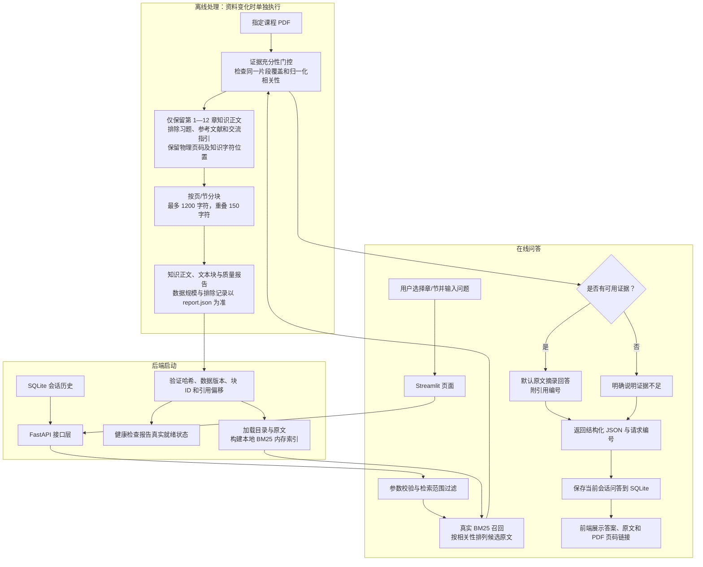
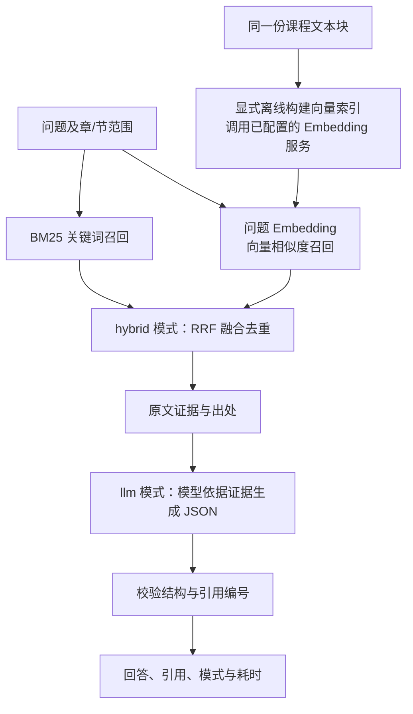
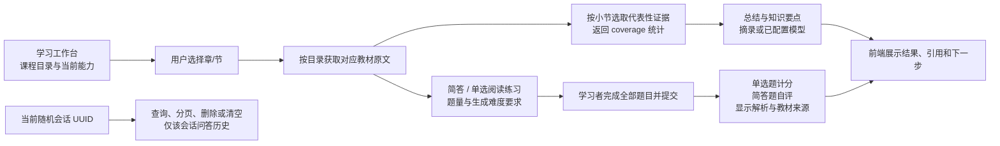

# 项目运行流程

更新：2026-10-25。当前 FastAPI 已具备业务接口，Streamlit 经 HTTP 接入；默认运行模式是 **真实 BM25 检索 + 带引用的教材原文摘录**，不是无配置的大模型生成。

## 一、当前可运行主线

- 前后端分别启动；Streamlit 请求 FastAPI，不直接导入后端模块或读取数据库。
- 没有模型密钥时默认摘录模式正常工作，并明确显示 `generation_mode=extractive`。
- 资料缺失/哈希不一致时健康状态为 degraded，业务返回 503；参数错误返回 422；不存在的章节/块返回 404。
- 原 PDF 从固定配置/来源报告定位，下载前校验来源哈希，不接受任意路径。
- 启动不重做清洗、不下载模型、不自动调用外部服务。

## 二、配置模型后的可选主线

向量/混合检索和模型生成是独立配置项，可单独开启。只有真正配置并构建匹配版本的向量索引后，健康检查才列出 vector/hybrid；缺依赖时返回 503，不使用伪向量。当前证据门控只对默认 BM25 完成种子校准；vector/hybrid 在页面标记为实验能力，不能复用 BM25 的课程外拒答结论。LLM 输出错误返回 502，超时返回 504。**本次未接入 Reranker 模型，也未完成模型回答质量评测。** 当前只有 20 题 BM25 种子评测，用于开发期防回归，不代替 60—100 题正式人工评测。

## 三、总结、练习和历史

总结不是把问答的少数相似片段冒充全章覆盖；coverage 说明实际选取范围。练习默认属于原文阅读自测，提交前不创建答案展示控件，提交后才显示反馈；简答题不做语义自动评分。总结和练习当前不写入问答历史。

接口详见 [后端文档](F:/桌面/毕设/docs/api-reference.md) 与 [前端接入文档](F:/桌面/毕设/docs/frontend-api.md)。

