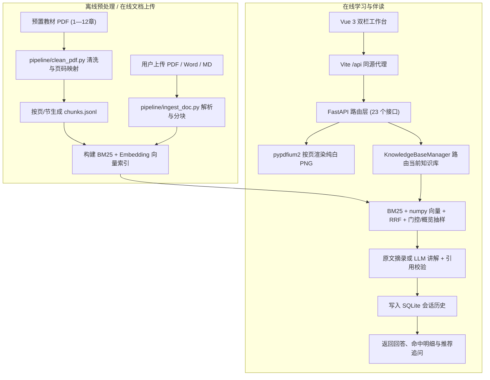

# 项目运行流程与阅读路线

更新：2026-11-28。本文按当前最新源码核对，说明系统如何运行以及阅读代码的推荐顺序。总入口见 [README](F:/桌面/毕设/README.md)，目录树见 [项目目录](F:/桌面/毕设/目录.md)。

## 一、先用一句话理解项目

这是一个面向课程教材与个人文档（PDF / Word / Markdown）的**混合检索增强学习与伴读工作台**：Vue 3 提供 6 个浅蓝白风格页面（含左原文伴读 + 右混合检索问答的双栏工作台），FastAPI 负责多知识库管理、BM25 + 向量 RRF 混合检索、证据门控、大模型讲解/总结/自测以及基于 SQLite 的会话历史持久化。

| 部分 | 负责什么 | 先看哪里 |
|---|---|---|
| Vue 前端 | 6 个页面、双栏 PDF 无黑边伴读、可拖动分割条与引用定位 | [App.vue](F:/桌面/毕设/frontend/src/App.vue)、[QuestionView.vue](F:/桌面/毕设/frontend/src/views/QuestionView.vue) |
| HTTP 接口 | 23 个路由、参数校验、PDF 按页 PNG 渲染、调度业务服务 | [routes.py](F:/桌面/毕设/backend/api/routes.py) |
| 多知识库与语料 | 预置课程加载、自定义知识库 CRUD、上传文档解析与建索引 | [knowledge_base.py](F:/桌面/毕设/backend/services/knowledge_base.py)、[corpus.py](F:/桌面/毕设/backend/services/corpus.py) |
| 混合检索 | BM25 + numpy 向量召回、RRF 融合、双保险门控与概览抽样 | [retrieval.py](F:/桌面/毕设/backend/services/retrieval.py) |
| 回答与学习服务 | 多轮指代补全、摘录/LLM 讲解、章节总结、自测与随堂出题 | [generation.py](F:/桌面/毕设/backend/services/generation.py)、[learning.py](F:/桌面/毕设/backend/services/learning.py) |
| 会话历史存储 | 按会话 UUID 与知识库隔离保存、查询和删除问答记录 | [history.py](F:/桌面/毕设/backend/storage/history.py) |

## 二、系统总图：离线/上传入库与在线伴读问答

- **预置语料**：Hello-Agents 第 1—12 章、67 节、759 块（PDF 物理页 10—560），来源与统计以 `data/processed/hello-agents/report.json` 为准。
- **自定义知识库**：用户可在「知识库」页面新建知识库并上传 `.pdf`、`.docx`、`.md` 文件，产物与索引保存在 `data/runtime/custom_kbs/` 下，随服务重启自动恢复。

## 三、一次伴读问答怎样走完前后端

以用户在双栏伴读页发送提问为例：

| 顺序 | 实际入口 | 输入、动作和输出 |
|---|---|---|
| 1 | [QuestionView.vue](F:/桌面/毕设/frontend/src/views/QuestionView.vue) 的 `ask` | 读取问题、`kb_id`、章/节范围、会话 UUID、证据条数 `top_k`；检索模式固定使用服务端默认值（`hybrid`） |
| 2 | [api.js](F:/桌面/毕设/frontend/src/lib/api.js) 的 `request` | 通过 `fetch` 向 `/api/qa` 提交 JSON（默认 90 秒超时），统一转换中文错误提示 |
| 3 | [routes.py](F:/桌面/毕设/backend/api/routes.py) 的 `question_answer` | 按 `models.py` 校验请求，定位目标知识库，加载同会话最近历史用于多轮指代补全 |
| 4 | [retrieval.py](F:/桌面/毕设/backend/services/retrieval.py) 的 `search` | 按章/节过滤，并行执行 BM25 与 `numpy` 向量余弦召回，经 RRF (`k=60`) 融合；通过词法或向量双保险门控（`VECTOR_MIN_SCORE=0.54`），概览类提问触发均匀抽样放行 |
| 5 | [generation.py](F:/桌面/毕设/backend/services/generation.py) 的 `answer` | `extractive` 返回原文摘录，`llm` 调用大模型生成结构化讲解与推荐追问，并校验引用编号；证据不足时明确拒答 |
| 6 | [history.py](F:/桌面/毕设/backend/storage/history.py) | 校验 `QAResponse` 后写入 SQLite 历史表，再返回响应 |
| 7 | [QuestionView.vue](F:/桌面/毕设/frontend/src/views/QuestionView.vue) 与 [SourceList.vue](F:/桌面/毕设/frontend/src/components/SourceList.vue) | 渲染结构化回答、混合检索命中标签（双路/BM25/向量/概览）与分数明细；点击「在左侧原文定位」自动切页并调用 `/page/{page_num}` 渲染对应纯白 PDF 页面 |

## 四、两个核心运行模式开关

| 配置项 | 代码默认值 | 含义与依赖 |
|---|---|---|
| `DEFAULT_RETRIEVAL_MODE` | `hybrid` | BM25 + Embedding 向量召回经 RRF 融合；需要匹配语料/模型的向量索引与可用 Embedding 服务 |
| `GENERATION_MODE` | `extractive` | 本地原文摘录；设为 `llm` 后调用配置的 Chat Completions 兼容大模型服务 |

健康检查（`GET /api/health`）核对本地语料、索引、配置与历史存储，不主动探测外部模型连通性；真实调用上游模型失败或超时时返回 `502 / 504`。

## 五、六个页面的衔接与状态流转

1. **课程目录（侧栏置顶）**：展示当前知识库统计、搜索章节，每张卡片提供「提问」「总结」快捷跳转，点击自动带入章节范围。
2. **AI 问答（双栏伴读）**：左侧为无黑边 PDF 按页预览（或非 PDF 连续正文切片）+ 中间可拖动分割条，右侧为混合检索问答、动态推荐提问与随堂出题巩固（`POST /api/quiz/from-qa`）。
3. **知识库**：切换预置课程或自定义知识库，支持新建/删除知识库、上传 PDF/Word/Markdown、在线预览原文档及分页查看文本块。
4. **问答历史**：按 `session_id` 分页回看历史提问与引用，支持单条删除与确认清空。
5. **章节总结**：顶部单行控制栏选章/节并一键生成总结、要点、覆盖统计与引用，底部提供「就本章继续提问」「练习巩固本章」闭环按钮。
6. **练习自测**：紧凑横排配置栏（题量、难度、胶囊题型多选），提交前隐藏答案，提交后单选题自动计分、简答题对照原文自评，支持仅重练错题与待复习题。

跨页共享状态集中在 [useWorkspace.js](F:/桌面/毕设/frontend/src/composables/useWorkspace.js)，由 `App.vue` 通过 `provide/inject` 注入，并用 `<KeepAlive>` 保留切页状态。

## 六、推荐代码阅读顺序

1. 入口与装配：`backend/main.py` → `frontend/src/App.vue` → `frontend/src/composables/useWorkspace.js`。
2. 混合检索核心：`backend/services/retrieval.py`（关注 `BM25Index`、`_rank_vectors`、`_fuse_rankings`、`_evidence_gate`、`is_overview_question`）。
3. 多知识库与入库：`backend/services/knowledge_base.py` → `pipeline/ingest_doc.py`。
4. 伴读交互：`frontend/src/views/QuestionView.vue` → `frontend/src/components/SourceList.vue`。
5. 契约与测试：`backend/schemas/models.py` → `tests/test_retrieval.py` → `tests/test_multi_kb_and_continuity.py`。
